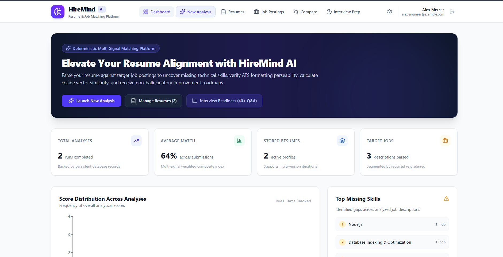

# HireIQ — AI-Powered Interview Preparation

**Prepare smarter. Practice confidently. Get interview-ready.**

HireIQ is a web application built to help candidates practise technical interviews and strengthen their problem-solving skills through guided DSA topics and mock interview sessions.

## Screenshots

### Home Page


### Mock Interview


## Highlights

- **Mock Interview Practice** — answer technical questions in a structured interview flow.
- **DSA Learning Hub** — explore core data structures, algorithms, and common problem-solving patterns.
- **Progress-Oriented Experience** — practise topic by topic and review your interview sessions.
- **Modern Web Interface** — a responsive frontend built with React and TypeScript.
- **Firebase Integration** — authentication and Firestore-based user data support.
- **Python API** — backend services built with FastAPI, with AI question generation powered through Ollama.

## Tech Stack

| Layer | Technologies |
|---|---|
| Frontend | React, TypeScript, Vite, Tailwind CSS |
| Backend | Python, FastAPI |
| Authentication | Firebase Authentication |
| Database | Cloud Firestore |
| AI | Ollama / local language model |

## Project Structure

```text
HireIQ/
├── hireIQ/             # Frontend application
│   └── src/
│       ├── components/ # Reusable UI components
│       ├── contexts/   # Authentication state
│       ├── lib/        # Firebase and shared utilities
│       └── pages/      # App pages
└── hireiq-backend/     # FastAPI backend
    └── app/
        ├── api/        # API routes
        ├── core/       # Configuration and security
        ├── db/         # Database integration
        └── services/   # Interview and AI logic
```

## Getting Started

### Prerequisites

- Node.js and npm
- Python 3.8 or newer
- A Firebase project with Authentication and Firestore configured
- Ollama installed with a compatible model available locally

### 1. Clone the repository

```bash
git clone https://github.com/shivarjunchaturvedi/HireIQ.git
cd HireIQ
```

### 2. Configure the frontend

```bash
cd hireIQ
npm install
```

Create a `.env` file in the `hireIQ` directory and add your Firebase web-app configuration:

```env
VITE_FIREBASE_API_KEY=your_api_key
VITE_FIREBASE_AUTH_DOMAIN=your_project.firebaseapp.com
VITE_FIREBASE_PROJECT_ID=your_project_id
VITE_FIREBASE_STORAGE_BUCKET=your_storage_bucket
VITE_FIREBASE_MESSAGING_SENDER_ID=your_sender_id
VITE_FIREBASE_APP_ID=your_app_id
```

Start the frontend:

```bash
npm run dev
```

### 3. Configure the backend

Open a second terminal:

```bash
cd hireiq-backend
pip install -r requirements.txt
```

Create a `.env` file in `hireiq-backend` with the backend settings:

```env
API_KEY=replace_with_a_long_random_secret
DB_KEY=path_to_firebase_service_account.json
MODEL_NAME=qwen3:0.6b
```

Set `DB_KEY` to the path of your Firebase service-account JSON file. **Never commit the service-account file or real secrets to GitHub.**

Run the API from the `hireiq-backend` directory:

```bash
python -m uvicorn app.main:app --reload --host 127.0.0.1 --port 8000
```

Make sure the Ollama service is running and the model configured in `MODEL_NAME` is available before using AI-powered endpoints.

## Interview API

The backend currently documents these interview routes:

- `POST /api/interview/start` — start an interview session.
- `POST /api/interview/interviews/{session_id}/answer` — submit an answer.
- `GET /api/interview/interviews/{session_id}/result` — retrieve interview results.
- `GET /api/interview/interviews/{session_id}/questions/{question_id}` — retrieve question feedback.

For the exact request payloads and current implementation, check the backend route files in `hireiq-backend/app/api/`.

## Security Notes

- Keep Firebase service-account credentials and backend secrets out of version control.
- Use environment variables for local configuration.
- Before deploying publicly, verify that every backend route authenticates the caller and checks ownership of the requested interview session.
- Use HTTPS and production-appropriate configuration when deploying.

## Current Scope

HireIQ is a project under development. Available functionality depends on the current frontend and backend implementation; configure Firebase and the local AI model before testing integrated workflows.

## Contributing

1. Fork the repository.
2. Create a feature branch.
3. Make a focused change.
4. Test the affected workflow.
5. Open a pull request with a clear description.

## License

MIT
